  

**Fullstack developer, backend at heart.** More at home with APIs, microservices and databases than fighting with CSS, and usually found tinkering with a homelab.

The image above is not a picture. It is the celestial body today is named after, ray-cast per character by [the code of samueleruaro.com](https://github.com/1brecane/portfolio) and redrawn here every night. Seven days, seven bodies.

  <picture>
    <source media="(prefers-color-scheme: dark)" srcset="https://raw.githubusercontent.com/1brecane/1brecane/output/github-snake-dark.svg">
    
  </picture>

  <picture>
    <source media="(prefers-color-scheme: dark)" srcset="assets/footer-dark.svg">
    
  </picture>

---

[`samueleruaro.com`](https://samueleruaro.com) &nbsp;·&nbsp; [`linkedin`](https://www.linkedin.com/in/samuele-ruaro-145251307/) &nbsp;·&nbsp; [`email`](mailto:samueleruaro@gmail.com)

📍 Verona, Italy

